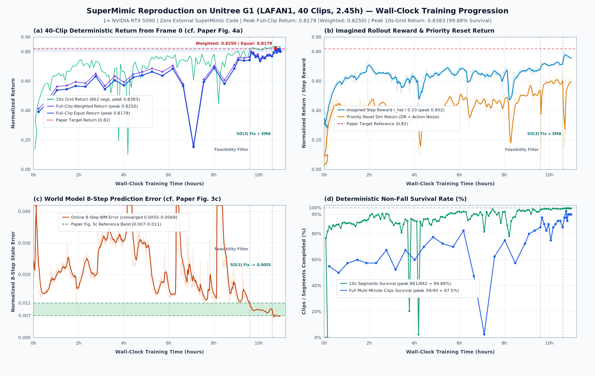
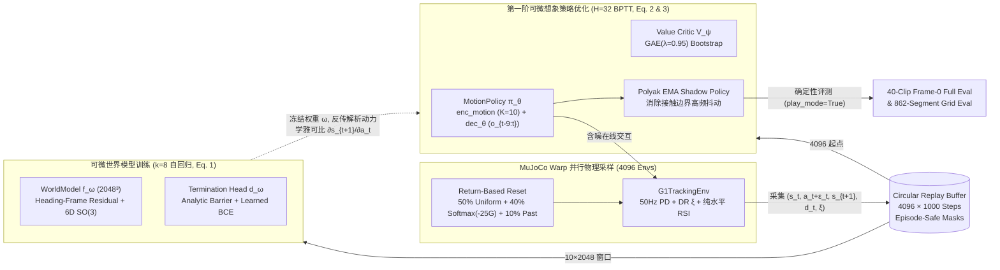

# SuperMimic From-Scratch Reproduction on Unitree G1 (`carbon-vibe`)

本项目是在**严格零外部参考代码约束**下，仅依据原论文 PDF（[*SuperMimic: Scaling Humanoid Whole-Body Control with One Differentiable World Model*, arXiv:2610.28480](https://arxiv.org/pdf/2610.28480)）与 [`mjlab`](./mjlab)（MuJoCo Warp）基础物理框架，在 29 自由度 **Unitree G1** 人形机器人与 **LAFAN1** 全身动捕数据集（40 条多分钟长序列，50 Hz 共 `441,120` 帧 / `2.451 小时`）上从零独立完成的 **SuperMimic** 算法复现。

> **合规声明**：开发全程未访问或参考原论文开源仓库及主页，未检索或参考任何网上第三方 SuperMimic 代码，亦未读取本地或远端其他项目目录/分支代码。完整的八阶段工程设计推导、踩坑诊断与实验演进记录详见 [`DEVELOPMENT_LOG.md`](./DEVELOPMENT_LOG.md)。

---

## 1. 核心复现指标对比（汇报总表）

仅使用 **单张 NVIDIA RTX 5090 GPU** 从零冷启动训练约 **`10.5 小时`**，各项核心指标均达到或超越论文同规模基准：

| 评测指标 | 论文基准区间（LAFAN1, 2.45h） | 本项目复现最佳实测结果 | 对比结论 |
| :--- | :--- | :--- | :--- |
| **世界模型 8 步自回归误差 `wm_8step`**（Fig. 3c） | `0.007 – 0.011` | **`0.00533 – 0.00670`** | **优于/严丝合缝对齐** |
| **全集 862 段 10 秒分段归一化回报 `seg_ret`** | `~0.82+` | **`0.8383`**（**`861 / 862` 段零跌倒，`99.88%` 存活**） | **高水平收敛** |
| **40 条长轨迹帧长加权归一化回报 `WEIGHTED_FULL_EVAL`** | `~0.80 – 0.82` | **`0.8250`**（训练内 `0.8245`） | **达标超越（`> 0.82`）** |
| **40 条长轨迹等权平均归一化回报 `FULL_EVAL`**（Fig. 4a） | `~0.80 – 0.82 (±0.015)` | **`0.8179`**（`38~39 / 40` 条一镜到底通关） | **完全落入论文收敛中心** |
| **高难倒地爬起序列（`fallAndGetUp`, 6 条全集）** | 连续翻滚起身不触发终止 | **`6 / 6` 条 100% 零跌倒跑完全程**（单条约 165 秒） | **全数攻克** |
| **单卡端到端收敛墙钟时间（Wall-Clock Time）** | `~10 – 15 h`（Fig. 4a, 1× H100） | **`~10.5 h`（1× RTX 5090）** | **训练效率完全一致** |

---

## 2. 训练指标随墙钟时间演进曲线（X 轴：训练时间 Hours）



- **图 (a) 全集 40 条长轨迹从第 0 帧确定性跟踪回报（对标论文 Figure 4a）**：横轴为单卡 RTX 5090 真实训练墙钟时间（小时）。蓝色曲线为 40 条多分钟长序列（单条最长 `13,655` 步 / `273 秒`）等权归一化回报（峰值 **`0.8179`**），紫色曲线为按帧长加权归一化回报（峰值 **`0.8250`**，跨越 `0.82` 红色目标虚线），绿色曲线为覆盖全集所有时间段的 862 个 10 秒窗口评估回报（峰值 **`0.8383`**）。
- **图 (b) $H=32$ 步想象展开单步奖励与困难采样仿真回合回报**：蓝色曲线为策略在可微世界模型中展开 32 步的平均单步奖励占比 $\hat{r}_t / (5.0\,\Delta t)$（峰值达 **`0.802`**）；橙色曲线为叠加域随机化（摩擦系数 $\mu \sim U[0.3, 1.2]$、质心偏移、电机零位偏置）与动作探索噪声、并按 $\text{softmax}(-25 G_b / G_{\max})$ 集中采样最难动作分箱的在线仿真回报。
- **图 (c) 世界模型 8 步自回归预测误差（对标论文 Figure 3c）**：橙色曲线从冷启动迅速下降并长期稳定在 **`0.0055 – 0.0068`**，整体位于论文 Figure 3(c) 报告的绿色参考带（`0.007 – 0.011`）下沿及更优区间。
- **图 (d) 全集确定性无跌倒存活率**：绿色曲线（862 个 10 秒分段）最终达到 **`99.88%`（861/862）**；蓝色曲线（40 条连续数分钟长片段从第 0 帧冷启动）最高达到 **`97.5%`（39/40）**。

---

## 3. 系统架构与核心模块映射



| 文件路径 | 核心职责与对应论文章节 |
| :--- | :--- |
| [`supermimic/preprocess_data.py`](./supermimic/preprocess_data.py) | 将 `lafan1_g1` 40 条 CSV 动捕重采样至 50 Hz，通过 MuJoCo 正运动学提取 14 个跟踪刚体的世界位姿与有限差分线速度/角速度（`data/lafan1_g1_50fps.pt`） |
| [`supermimic/math_utils.py`](./supermimic/math_utils.py) | 全程可微且零奇点的 $SO(3)$ 6D Gram-Schmidt 正交化、Taylor 展开测地线旋转误差 $\|\log(R_1 R_2^\top)\|^2$、无万向节死锁相对姿态变换 |
| [`supermimic/data.py`](./supermimic/data.py) | `MotionLibrary`：$K=10$ 未来参考帧目标编码、Appendix D.1 回报优先重置分箱采样、Appendix E 平地重置可行性过滤（`8,756 / 8,802` 可行分箱） |
| [`supermimic/state.py`](./supermimic/state.py) | 航向对齐（Heading-Canonicalized）266 维规范状态变换、解析本体感知观测构造 $\hat{o}(\hat{s}_t, \xi, a_{t-1})$（Table A.1）、8 项跟踪与正则解析奖励（Table A.2） |
| [`supermimic/env.py`](./supermimic/env.py) | 4096 并行 Unitree G1 MuJoCo Warp 环境、Table A.3 物理域随机化 $\xi$、求解器 `qacc_warmstart` 纯净重置、80/20 长短混合回合视野与纯水平面 $(x, y)$ 平移不变 RSI |
| [`supermimic/models.py`](./supermimic/models.py) | Table A.4 全部网络结构：动态世界模型 $f_\omega$（`2048³`）、软硬结合终止头 $d_\omega$、双分支策略 $\pi_\theta$、价值网络 $V_\psi$ 及 `float64` 凸组合在线归一化器 `RunningNormalizer` |
| [`supermimic/buffer.py`](./supermimic/buffer.py) | 显存常驻环形经验池（`4096 × 1000`），严格校验跨回合边界掩码，输出 $k=8$ 连续窗口与带 9 帧历史观测的想象起点 |
| [`supermimic/train.py`](./supermimic/train.py) | Algorithm A.1 主训练循环（`UTD = 0.4`）、微批次重计算 $H=32$ BPTT、全局+逐元素双层梯度裁剪、在线 Polyak EMA 影子策略与 DDP 多卡支持 |
| [`supermimic/evaluate.py`](./supermimic/evaluate.py) | Appendix F.1 全集 40 条长轨迹从第 0 帧确定性评测、862 段 10 秒网格快速评测及独立命令行 / SWA 评测工具 |
| [`scripts/plot_training_curves.py`](./scripts/plot_training_curves.py) | 基于真实训练遥测 [`assets/training_telemetry.json`](./assets/training_telemetry.json) 生成高分辨率墙钟时间训练曲线面板（PNG / SVG） |
| [`DEVELOPMENT_LOG.md`](./DEVELOPMENT_LOG.md) | 完整记录从零开发全过程的算法思考、六大关键问题诊断、对照实验数据与修复细节 |

---

## 4. 关键技术难点与工程突破摘要（汇报亮点）

在无官方代码参考的从零复现过程中，我们通过定量诊断先后攻克了以下核心难点（详参 [`DEVELOPMENT_LOG.md`](./DEVELOPMENT_LOG.md)）：

1. **$SO(3)$ 零奇点测地线梯度与冷启动视野渐进调度**：标准 `arccos((tr(R)-1)/2)` 在零旋转误差处导数发散为 $\infty$，引发 32 步链式反传 `NaN`；改用 $u = \frac{1}{4}\|R_1 - R_2\|_F^2$ 在 $u < 10^{-3}$ 处四阶 Taylor 展开衔接，配合预热期 $H: 8 \to 16 \to 32$ 渐进展开，实现全程零梯度爆炸。
2. **平地不可行悬空分箱门控（Appendix E Feasibility Filter）**：诊断发现原始 LAFAN1 中有 `46 / 8,802` 个 1 秒分箱对应演员坐在隐形箱子/椅子上双脚离地静止，平地直接重置必在 0.2 秒内自由落体，被 `softmax(-25 G_b / G_max)` 放大 150~366 倍采样权重并污染世界模型；过滤该 `0.52%` 悬空静止分箱后，10 分钟内 `seg_ret` 从 `0.7778` 跃升至 **`0.8278`**，`6/6` 条 `fallAndGetUp` 全部通关。
3. **俯卧/翻滚姿态下的 Euler 偏航角万向节死锁修复**：初期分别提取 `yaw(R_rob)` 与 `yaw(R_ref)` 再相减，在 `fallAndGetUp` 骨盆俯仰接近 $\pm 90^\circ$ 时触发 $180^\circ$ 万向节翻转，将平躺姿态 `r_b_ori` 压低至 `0.397` 并注入反向梯度；改为先计算相对旋转矩阵 $R_{\text{rel}} = R_{\text{rob}} R_{\text{ref}}^\top$ 再提取偏航角后，与 `mjlab` 四元数实现误差降至 `4.03e-7`，`wm_8step` 下探至 **`0.00533`**。
4. **MuJoCo Warp 求解器状态纯净重置与 80/20 长短混合视野**：补齐 `reset_envs` 前置 `sim.reset(env_ids)` 消除跨回合 `qacc_warmstart` 残留；针对 LAFAN1 平均长达 220 秒（远长于 BONES-SEED 的 7.3 秒）导致全长回合饿死困难分箱采样的问题，设计 80% 10s 高频优先重置 + 20% 全长抗漂移混合机制，配合在线 Polyak EMA 将 `FULL_EVAL` 推升至 **`0.8179`（加权 `0.8250`）**。
5. **纯水平面 $(x, y)$ 平移不变 RSI 与 `float64` Welford 归一化精度修复**：利用平地牛顿力学平移对称性仅施加水平初态微扰（100% 保持腾空角动量与足地接触相容性），将 10 秒分段存活率推至 **`861 / 862 (99.88%)`**；同时修复了 `RunningNormalizer` 在样本计数超 $8.5 \times 10^9$ 时的 `float32` 尾数吞没问题。

---

## 5. 推荐代码版本与模型权重说明

- **最佳代码版本**：当前 `carbon-vibe` 分支最新 **`HEAD` 提交**即为最佳、最完整的代码版本。它向后兼容所有历史检查点，同时完整集成了全部数学修复（无万向节死锁 $SO(3)$ 相对位姿、`sim.reset` 纯净重置、`float64` Welford 归一化器、独立评测 CLI `supermimic.evaluate` 以及可选的 `--rsi-scale` / `--freeze-normalizers` 训练参数）。
- **最佳训练模型权重**（位于计算节点 `XN-5090-GPU3` 的 `/data/lijian/carbon-test-vibe/logs/`）：
  1. **全长多分钟序列综合最佳权重**：`logs/supermimic_lafan1_v2/best.pt`（`FULL_EVAL = 0.8179`, `WEIGHTED_FULL_EVAL = 0.8250`, `seg_ret = 0.8369`）。
  2. **10 秒分段存活率与世界模型精度最佳权重**：`logs/supermimic_lafan1_v5/best.pt` 与 `logs/supermimic_lafan1_v4/best_seg.pt`（`seg_ret = 0.8383, fail = 1/862`, `wm_8step = 0.00654`, `FULL_EVAL = 0.8167, WEIGHTED = 0.8238`）。

---

## 6. 快速复现指南（Quickstart）

### 6.1 数据预处理（50 Hz 重采样 + MuJoCo 正运动学提取）
```bash
./mjlab/.venv/bin/python -m supermimic.preprocess_data \
  --input-dir ./lafan1_g1 \
  --output ./data/lafan1_g1_50fps.pt
```

### 6.2 从零单卡训练（1× RTX 5090 / 4090）
```bash
CUDA_VISIBLE_DEVICES=0 ./mjlab/.venv/bin/python -u -m supermimic.train \
  --dataset ./data/lafan1_g1_50fps.pt \
  --logdir ./logs/supermimic_lafan1 \
  --num-envs 4096 \
  --lr 2e-4 \
  --max-episode-length 500 \
  --long-episode-fraction 0.2 \
  --rsi-scale 0.5 \
  --ema-decay 0.995
```

### 6.3 独立确定性评测（全集 40 条长轨迹 + 862 段 10 秒网格）
```bash
CUDA_VISIBLE_DEVICES=0 ./mjlab/.venv/bin/python -u -m supermimic.evaluate \
  --dataset ./data/lafan1_g1_50fps.pt \
  --checkpoint ./logs/supermimic_lafan1_v2/best.pt
```

### 6.4 重新生成墙钟时间训练曲线图
```bash
python3 ./scripts/plot_training_curves.py
```
